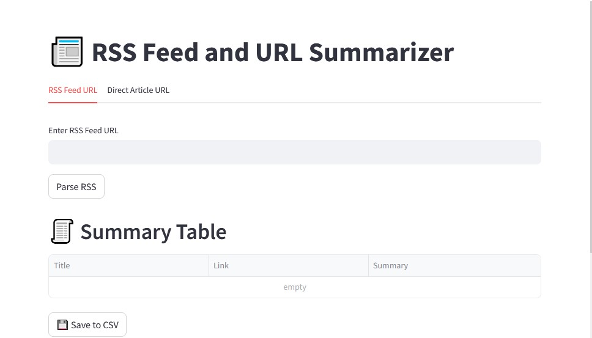

# 🧠 RSS & URL Summarizer Suite & API

[](https://www.python.org/)
[](https://streamlit.io/)
[](https://fastapi.tiangolo.com/)
[](https://platform.openai.com/)
[](https://www.docker.com/)

A comprehensive web content extraction, intelligent summarization, and data management platform. It offers both an interactive **Streamlit** multi-page web application and a **FastAPI** REST backend powered by **Newspaper3k**, **Feedparser**, and **OpenAI**.

---

## 🌟 Key Features

- **📰 RSS Feed Ingestion & Parsing**: Automatically fetch, parse, and process articles from any standard RSS feed.
- **🌐 Direct URL Web Scraping**: Extract clean article text and metadata from arbitrary web pages using `newspaper3k`.
- **🤖 AI-Powered Summaries**:
  - Clear, 1–2 sentence **TL;DR**.
  - **Key bullet points** and takeaways.
  - Contextual **hashtags** for easy categorization and social media sharing.
- **📄 Batch Processing via CSV**: Upload CSV files containing URL lists to summarize content in bulk with progress tracking.
- **🧹 CSV Merging & Deduplication**: Combine multiple extracted CSV reports and eliminate duplicate entries automatically based on link URLs.
- **⚡ High-Performance REST API**: Fast, lightweight API endpoint (`POST /summarize`) with auto-generated Swagger UI.
- **🐳 Docker Ready**: Single container orchestration to run both FastAPI and Streamlit concurrently.

---

## 🏗️ Project Structure

```text
.
├── .env.example                         # Sample environment variables
├── Dockerfile                           # Docker configuration (Python 3.11-slim)
├── requirements.txt                     # Project dependencies
├── start.sh                             # Container startup script
├── api.py                               # FastAPI REST backend service
├── app.py                               # Streamlit home / landing page
│
├── images/                              # Application screenshots & module demos
│   ├── home.png
│   ├── rss_url_summarizer.png
│   ├── csv_summarizer.png
│   ├── merge_deduplicate.png
│   └── fastapi_docs.png
│
├── pages/                               # Streamlit multi-page interface
│   ├── 1_RSS_and_URL_Summarizer.py      # RSS feed & direct URL scraper/summarizer
│   ├── 2_Summarize_from_CSV_URLs.py     # Batch article summarizer from CSV
│   └── 3_Merge_and_Deduplicate_CSVs.py  # CSV merger and deduplication utility
│
└── rss_parser/                          # Core scraping and NLP package
    ├── __init__.py
    └── parser.py                        # Scraping, parsing, and OpenAI logic
```

---

## 📸 Working Modules & Screenshots

### 1. Home Dashboard
The landing page introducing the suite, navigation instructions, and available tools.


---

### 2. RSS Feed & Direct Article URL Summarizer
Fetch articles from live RSS feeds or parse individual URLs. Summarizes content using OpenAI GPT-3.5 with key insights, TL;DR, and hashtags, with instant CSV export.


---

### 3. Batch Summarization from CSV URLs
Upload any CSV containing article URLs, track batch progress in real-time, and download the enriched dataset with extracted text and AI summaries.


---

### 4. Merge CSVs & Remove Duplicates
Upload multiple CSVs from previous scrape sessions, consolidate them into a single clean file, and automatically deduplicate rows by URL link.


---

### 5. FastAPI Interactive Documentation (Swagger UI)
REST API service with auto-documented endpoints at `/docs` to integrate scraping and summarization into external workflows.


---

## 🛠️ Tech Stack

- **Backend & API:** [FastAPI](https://fastapi.tiangolo.com/), [Uvicorn](https://www.uvicorn.org/)
- **Frontend / UI:** [Streamlit](https://streamlit.io/)
- **Web Scraping & RSS:** [newspaper3k](https://newspaper.readthedocs.io/), [feedparser](https://feedparser.readthedocs.io/), [BeautifulSoup4](https://www.crummy.com/software/BeautifulSoup/)
- **AI & NLP:** [OpenAI API](https://platform.openai.com/), [NLTK](https://www.nltk.org/)
- **Data Handling:** [Pandas](https://pandas.pydata.org/)
- **Containerization:** [Docker](https://www.docker.com/)

---

## 🚀 Getting Started

### Prerequisites

- Python 3.10 to 3.13
- An [OpenAI API key](https://platform.openai.com/api-keys)

### 1. Clone Repository & Setup Environment

```bash
git clone https://github.com/your-username/WebScrapper-Summarizer-and-API.git
cd WebScrapper-Summarizer-and-API
```

Create and activate a virtual environment:

- **Windows (PowerShell):**
  ```powershell
  python -m venv venv
  .\venv\Scripts\Activate.ps1
  ```
- **Linux / macOS:**
  ```bash
  python3 -m venv venv
  source venv/bin/activate
  ```

### 2. Install Dependencies

```bash
pip install -r requirements.txt
python -m nltk.downloader punkt punkt_tab
```

### 3. Configure Environment Variables

Create a `.env` file in the project root:

```env
OPENAI_API_KEY=your_openai_api_key_here
```

---

## 💻 Running Locally

### Option A: Streamlit Web UI

Run the multi-page Streamlit application:

```bash
streamlit run app.py
```

Open your browser and navigate to **`http://localhost:8501`**.

#### Included Tools:
1. **RSS and URL Summarizer**: Input an RSS feed URL or individual article link, summarize with GPT-3.5, and export results to CSV.
2. **Summarize from CSV URLs**: Upload a `.csv` file with a `Link` column to batch process articles.
3. **Merge and Deduplicate CSVs**: Upload multiple CSV files, merge them, remove duplicate URLs, and download the consolidated dataset.

---

### Option B: FastAPI REST Backend

Start the FastAPI development server:

```bash
uvicorn api:app --reload --host 127.0.0.1 --port 8000
```

- **Interactive API Documentation (Swagger UI):** [`http://127.0.0.1:8000/docs`](http://127.0.0.1:8000/docs)
- **ReDoc Documentation:** [`http://127.0.0.1:8000/redoc`](http://127.0.0.1:8000/redoc)

#### Endpoint: `POST /summarize`

**Request Body:**
```json
{
  "urls": [
    "https://example.com/article-1",
    "https://example.com/article-2"
  ]
}
```

**Response Example:**
```json
{
  "results": [
    {
      "url": "https://example.com/article-1",
      "content": "Extracted text content...",
      "summary": "**TL;DR**: Quick summary.\n\n**Key Points**:\n- Insight 1\n- Insight 2\n\n#Technology #AI"
    }
  ]
}
```

---

## 🐳 Running with Docker

You can build and run both Streamlit and FastAPI concurrently in a Docker container:

```bash
# Build the Docker image
docker build -t rss-summarizer-suite .

# Run the container with environment variables
docker run -p 8000:80 -p 8501:8001 --env-file .env rss-summarizer-suite
```

- **Streamlit Web UI:** `http://localhost:8501`
- **FastAPI Documentation:** `http://localhost:8000/docs`

---

## 📄 License

This project is licensed under the MIT License - see the LICENSE file for details.

